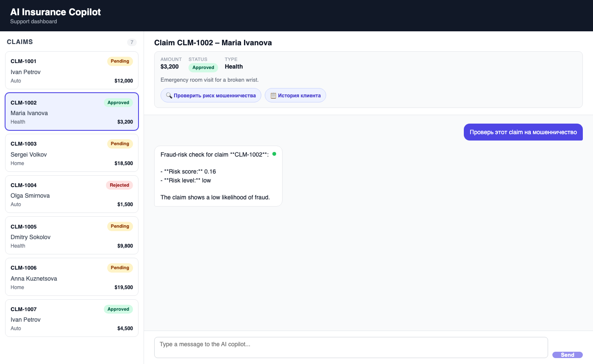
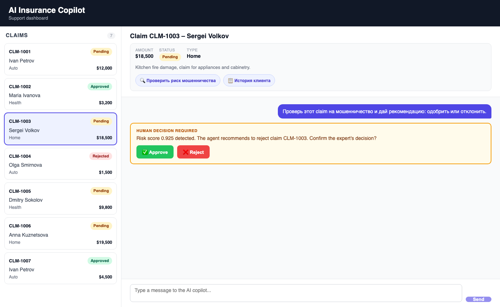

# AI Insurance Copilot

An AI copilot for insurance support agents: it looks up claim data, checks fraud risk, pulls customer history, and pauses for a human's Approve/Reject decision on high-risk claims — with every answer silently fact-checked by an independent AI judge.



## Architecture

- **Backend** ([`backend/`](backend/)) — FastAPI + SQLite. Serves the claims list/detail REST endpoints and hosts the 3 tool functions (`get_claim_details`, `check_fraud_risk`, `get_customer_history`) the agent calls.
- **Frontend** ([`frontend/`](frontend/)) — React + Vite. Claims dashboard, per-claim chat panel, and the Approve/Reject UI.
- **LangGraph agent** ([`backend/agent.py`](backend/agent.py)) — a tool-calling loop over a Groq-hosted LLM, with a human-in-the-loop (HITL) checkpoint that pauses the graph when the agent is about to recommend approving or rejecting a high-risk claim.
- **AI Judge** ([`backend/judge.py`](backend/judge.py)) — a separate, independent LLM call that grades every agent answer for groundedness (are the stated facts actually backed by tool data, or invented?) and relevance, after the answer is produced.

The full fixed API contract and component responsibilities are documented in [00_architecture.md](00_architecture.md).

## Key features

- **Human-in-the-loop approval flow** — when fraud risk crosses a threshold and the agent is about to propose an approve/reject recommendation, it pauses and asks a human expert to confirm before the decision counts as final. Includes safeguards against the interrupt firing again for an unrelated question or an already-confirmed decision.
- **Independent groundedness judge** — a second model call checks every answer strictly against the real tool outputs the agent actually retrieved, rather than trusting the agent's own claims, and is backed by a deterministic check that catches outright invented claim IDs even if the judge model itself misses them.
- **Persistent chat history** — conversations survive switching between claims; reopening a claim restores the full back-and-forth from the backend's LangGraph checkpointer instead of showing an empty chat.
- **Resilient interrupt recovery** — if an employee navigates away before clicking Approve/Reject, reopening the claim restores the live, still-clickable decision card instead of losing the pending interrupt.
- **Claim context at a glance** — opening a claim shows its key facts (amount, status, type, description) plus quick-prompt suggestions, without spending an LLM call until the employee actually chooses to ask something.

## Tech stack


## Running locally

### Prerequisites
- Python 3.11+
- Node.js 18+
- A free [Groq API key](https://console.groq.com)

### 1. Clone

```bash
git clone https://github.com/Sskrepkaa/ai-insurance-copilot.git
cd ai-insurance-copilot
```

### 2. Backend

```bash
cd backend
python3 -m venv venv
source venv/bin/activate
pip install -r requirements.txt

cp .env.example .env
# edit .env and set GROQ_API_KEY to your actual key

uvicorn main:app --reload --port 8000
```

The SQLite schema is created and seeded with demo data automatically the first time the server starts — no separate seed step needed.

### 3. Frontend

In a separate terminal:

```bash
cd frontend
npm install
npm run dev
```

### 4. Open it

Visit **http://localhost:5173** — the dashboard should load with 7 seeded demo claims. Click one to start chatting with the copilot.

## Demo

The Approve/Reject card that appears when the agent flags a claim as high fraud risk and is about to recommend a decision:


